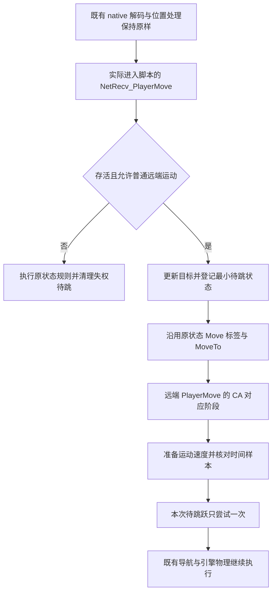

# 其他角色跳跃与位置同步优化方案

> **现行入口：2026-11-17 攻击加速度补齐候选。** 在 2026-11-16 CA 普通远端移动与跳跃候选上，补齐弓手攻击入口和近战队列的普通远端加速度清理，保留现有业务、Walking 和跳跃。新组合已完成必要本地验证，未自动部署，往返移动是否消除待游戏确认。当前产出及摘要见[最新实施进度](REMOTE_PLAYER_MOVEMENT_IMPLEMENTATION_PLAN.md#2026-11-17-弓手与近战队列加速度补齐)，依据见[攻击链分析](REMOTE_PLAYER_MOVEMENT_EVIDENCE.md#2026-11-17-攻击加速度差异与视频反馈)。2026-11-16 三处原生补丁继续保留；更早记录仅用于各自历史阶段。

## 目标和业务边界

仅对有效其他玩家 Hero 的普通移动与跳跃采用 CA 的单目标登记、累计帧时、三维速度建立和延后起跳，在既有 `PlayerTick → 状态 PlayerMove` 中接入。2026-11-17 另将弓手攻击入口和近战队列的普通远端加速度清理按 CA 补齐；保留本地输入、攻击收发/收尾/冲刺登记顺序、商城、排行榜、合成、跨服和光效。硬控、冲刺、击退、死亡、摆摊、模态和召唤继续按现有业务接管。

原生候选以 `Bin/Sephiroth.dll` 的 SHA-256 `e20b332cee1cff232a85f0a6b2aa67ff752ff281694f66fd30b402ece3376209` 为唯一输入，生成文件 SHA-256 为 `9d1e37d980407d01226120004deb4b9a14acab66cf2a0140ba75697b74153ab2`。本轮重新生成的 DLL 与 2026-11-16 候选逐字节相同，没有追加 DLL 或 C++ 修改；仅修改 ClientController、NephilimPlayer 两份业务脚本并重新构建 SPG，原 Bin 文件及旧交付包未覆盖。

## 2026-11-17 攻击入口补齐约定

- 新增 `ClearRemoteCAAttackAcceleration`，供父类队列和派生弓手在原业务线程执行完整清理动作；内部复用私有 `CanApplyRemoteCAMotion` 判断控制权，不复制身份或业务规则，不缓存对象。
- 弓手保留原 `IsAvatar() || !bIsMoving` 清理；原先跳过清理的分支调用上述入口。普通远端即使仍有位置误差也清零加速度；被业务接管及非目标对象保持原分支行为。
- 近战队列保留本地清理，原远端分支调用上述入口，位置仍在 `BeginRemoteSkillDashLock` 及后续技能回调之前；不更改队列出入、技能发送或冲刺登记时序。
- 新入口只写 `Acceleration`，不写 Velocity/Velocity.Z、JumpZ、Destination、待跳类型、累计帧时、Walking 或物理状态；本轮不修改弓手输入轴、攻击结束方法、法师施法和 DLL 近战位置修正。

## 差异对比与实际进度

| 范围 | 本轮处理 | 当前进度 |
| --- | --- | --- |
| 普通远端移动 | 收包登记目标，后续按累计帧时建立三维 Velocity，再尝试跳跃；普通包可覆盖待跳。 | 既有脚本保留，当前组合通过 97 项受控 VM 断言，含新增 11 项攻击清理边界。 |
| 跳跃动画与落地 | 父类 DoJump 成功后才切空中姿态，慢走乘运行时 WalkingPct；普通远端落地保留目标。 | 已包含于两份重新构建的 SPG；Tween 不等于完整跳跃序列已续播，视觉待验。 |
| 跳跃前 FarMove | 生产 `0x656FA` 命中门禁时取消搬移，并恢复参数栈约定；未命中走原调用。 | 独立 DLL 已实现并本地验证。 |
| 水平零位移过滤 | 生产 `0x65843` 命中门禁时放行纯垂直变化及重复坐标。 | 独立 DLL 已实现并本地验证。 |
| 小位移过滤 | 生产 `0x658D8` 命中门禁时放行小位移，进入普通事件与 Walking。 | 独立 DLL 已实现并本地验证。 |
| 身份与业务接管 | 原生同步查询现有 CanApplyRemoteCAMotion，不另写对象偏移和业务规则；拒绝或缺函数时重放原分支。 | 同字节 DLL 的 2026-11-16 历史 154 组原生检查及 7 组 UCC 互操作通过；本轮攻击清理边界另经受控 VM 验证。 |
| 攻击加速度 | 普通远端弓手攻击及近战队列按 CA 清理，业务接管仍沿用现有规则。 | 当前实际编译包的两个调用点及清理入口完整解析；374 份其他输入文件哈希、两份源码其余 token 不变。 |
| 游戏验收 | 用户反馈上一版跳跃正常，观察端跳攻后往返移动；已配套替换三文件。 | 本轮新包往返移动效果待确认；尚未自动部署。 |

## 保留要求及验证边界

普通回调后的 `SetPhysics(Walking)` 调用点字节未改，历史坐标 X 为零哨兵、超过 2000 的修正及原生产地速处理继续保留。30/2000 为相邻网络坐标的三维位移，不能与 Pawn 到目标误差混用。未复用旧 Main 取消 Walking 的逻辑，也未改复活定位、近战通知、地图下界、怪物/宠物碰撞和全局默认参数。

测试只需配套使用交付包的 `Sephiroth.dll`、`Sephiroth.spg`、`SephirothUI.spg`；不替换 Engine/Core/SEP，不安装 Triumphus。当前算法与三处行为对齐不等于相同跳高、动画节奏或整套 DLL 等价。

当前组合完成 UCC 构建 0 错误、55 警告、实际模块路径/摘要核对、97 项受控脚本 VM 断言及实际编译方法检查。154 组原生检查和 7 组真实 UCC 门禁属于 2026-11-16 同字节 DLL 的历史结果，本轮没有重复执行，不计作新增验证。CA 完整启动环境缺失，生产 SPC32/SPM 后续修改未动态排除；本地结果不代替游戏验收。必要检查已结束，完整产出和替换要求统一见实施进度。

## 以下为 2026-11-09 及此前历史记录

> 2026-11-09：用户此前要求还原前端脚本；随后要求添加远端跳跃文件诊断，当前工作树在还原基线上增加诊断而未有意改变移动/动画业务。当前诊断包、静态对照与实际落盘限制见[最新实施记录](REMOTE_PLAYER_MOVEMENT_IMPLEMENTATION_PLAN.md)。下方 CA 对照候选和 Main 方案均为历史记录，不代表当前源码或游戏运行文件。

## 2026-11-09 历史：CA 远端移动对照候选

用户要求远端角色移动、跳跃和相关 DLL 行为恢复至 CA。当前脚本在既有状态调度内采用 CA 的累计帧时、单一运动类型、三维速度、走路跳跃缩放及 0.5 秒空中动画过渡；原 Main 的远端专用钩子候选不再是本次交付。脚本改动仅针对远端角色，项目其他业务及特殊状态并非整个客户端照搬 CA。具体实现、验证和未核实差异见[实施记录](REMOTE_PLAYER_MOVEMENT_IMPLEMENTATION_PLAN.md)。

本次候选以原生产 `Bin/Sephiroth.dll` 为 DLL，已核查的远端运动入口及两处近战位置处理与 CA 同源；生产与 CA 整 DLL、引擎文件不相同，未证明所有调用链完全一致。工作区原生产 DLL 原本即为此版本，无需覆盖。2026-11-09 随后按用户要求再次对齐 CA 的远端身份、接收和落地核心入口，新构建和测试以[实施记录最新节](REMOTE_PLAYER_MOVEMENT_IMPLEMENTATION_PLAN.md)为准；此前 CA 候选、Main 候选及下方原文均供历史追溯。脚本与原生产 DLL 的隔离构建、类加载和受控测试通过，**实际游戏未部署、未进行联网或地图验收**。

## 以下为 2026-11-08 Main 方案和历史记录

更新日期：2026-11-08。适用项目：`easy-game-ui`。状态：**首版代码和隔离测试候选已生成，完整编译及受控验证通过，联网游戏验收待进行；生产 Bin DLL 未覆盖，Hero 和 UI 业务脚本未改**。本文是该主题现行方案入口；逐项执行顺序和验收见[代码实施计划](REMOTE_PLAYER_MOVEMENT_IMPLEMENTATION_PLAN.md)。本方案替代下方“以 CA 脚本为基线、保留 DLL”的旧实施要求，不抹除已发生的候选、用户反馈与回滚事实。文档更新不构成新方案的代码或 C++ 修改授权。

## 现行方案：参考远端 Main 的远端运动链

### 目标、基线和证据边界

在当前项目保留本地角色及已有技能、硬控、冲刺、摆摊和跨服功能的前提下，以用户提供的[远端 Main 成品及记录](../远端Main/安装与修改记录.txt)为行为参照，适配远端玩家跳跃、位置同步和动画。方案目标是减少已观察到的普通同步高速反向和空中向上速度重写，并避免起跳、落地及技能状态互相覆盖；效果以同场景联网验证为准。

以下还原事实属于编码前基线，后续首版实现见实施计划第七节。2026-11-08 按用户要求将 `ClientController.uc`、`Character.uc`、`Hero.uc` 还原至当前功能分支的试验前基线；三个文件均与 `HEAD` 工作树规范化内容一致且相对 `HEAD` 无差异，不是远端 Main 或新方案实现。还原前 CA 精简诊断源码及摘要保存在[还原前快照](../.weapon-fx-work/backups/remote-jump-before-restore-20261108-212502-547533/manifest.json)，已有测试包保留；三项现有 DLL 的摘要未变。未重新编译或部署，源码恢复不代表游戏运行包已变更。试验前实现包含接收时立即起跳、分段加速追赶和地面防卡等既有行为，还原不代表回弹或闪现问题解决。用户反馈 Falling 保留 Z 试验出现严重回弹和闪现，该试验此前已撤销；不能将其等同远端 Main 的完整空中运动。先前截图记录过水平速度约 518→2390 且几乎反向、普通同步将 Z 从 0 写成约 +132，以及 Jump Tween 后停帧；它们证明对应时点的脚本状态变化，不能单独证明 native 入口一定命中或某次视觉回弹的全部成因。

参考成品的 `Sephiroth.dll` 和 `Engine.dll` 摘要分别为 `7e015927fd34…`、`e05ce59722d3…`，当前 `Bin` 分别为 `e20b332cee1c…`、`d555c0a3be74…`。参考成品中六个 DLL 均与当前同名 DLL 不同；其中当前 `Sephiroth.dll` 与参考补丁配方输入一致，但当前 `Engine.dll` 不是其配方输入。参考成品与仓库记录的补丁目标哈希一致，并不证明游戏进程实际加载了它们。远端 Main 随附脚本文本可能与成品字节码存在历史差异，实施前应核对关键实际执行函数。

`远端Main` 和 `Bin-CA` 是本地未跟踪样本，链接仅用于本工作区对照，不代表成品已纳入仓库；不得为保证链接而将整套二进制加入版本库。后续实际构建和测试须单独固定样本、完整摘要及来源。

当前和远端 Main 实际 `Engine.dll` 的 `FarMoveActor`、`calcVelocity`、`performPhysics`、`physFalling`、`physWalking`、`setPhysics` 六处导出比较范围机器码及范围内重定位一致；这支持核心物理同源，但不证明所有外围调用、辅助函数或 DLL 全部相同。此前[代码与 DLL 分析记录](REMOTE_PLAYER_MOVEMENT_EVIDENCE.md)描述 CA 与当时基线，属于历史证据，不应扩展成远端 Main 与当前项目 DLL 相同。

### 配套运动契约

1. **接收及物理状态**：主移动入口首版已适配 Main 对远端角色的消息交付与物理状态处理，包括跳跃前绕过旧 `FarMoveActor`、普通消息回调后绕过旧 `setPhysics(Walking)`；门禁未命中保留生产路径。该项必须从 Main 累计补丁中拆出，与下述保留生产校验及字段时序的决定兼容，不能整体复用钩子。首版对命中远端门禁的普通包直接交付脚本，保留生产 x87 地速处理、前置坐标写入与分支尾部历史坐标提交；三处入口由独立补丁生成器适配。原生与脚本共同决定空中物理时序，不能只在脚本消费时判断 `PHYS_Falling` 并假定 Z 从未被改写。
2. **最新样本及待跳**：普通位置维护最新目标、方向样本和有效速度；跳跃待处理状态与普通位置分离，避免普通包覆盖待跳。参考 Main 主要只保留一个最新位置和一份待跳，不能承诺多次同时到达的跳跃均完整排队。跳跃消息中 Acc/JumpZ、走跑状态和方向的取值时机须按实际代码和数据核对。
3. **地面与空中运动**：2026-11-08 用户确认本项保留当前脚本的 Tick 与攻击状态调度，不采用 Main 正常远端 `PlayerTick` 执行运动模块后直接返回、跳过原状态 `PlayerMove` 的方式。保留当前 `PlayerTick → PlayerMove` 调用、各状态继承及导航配合，攻击命中、消息发送与动作收尾沿用当前脚本。Main 的地面限速、物理摩擦及空中 XY 运动只作为算法参考：空中可参考相邻接收位置推断方向和速率，侧向修正受同一速度预算约束，正常空中分支只写 XY；起跳、重力、碰撞和落地继续改变 Z，真实空中反向应允许转向。首版在 `Approaching.PlayerMove` 既有远端分支调用控制器内部运动准备，保留原攻击子状态父调用和 MoveTo；没有独立 Tick/Step。实际帧内导航与物理先后及联网效果仍需游戏验证。
4. **落地及接管**：对已经越过且侧向偏差较小的旧目标避免落地回拉；硬控、冲刺、击退、死亡、摆摊、切图与对象销毁继续按当前项目规则接管及清理，不能补播失权旧跳或让两套运动算法同时写速度。实际落地、技能/受击动画和本地角色保持其各自的控制权。
5. **走路起跳与动画**：Main 的远端起跳会临时令 `bIsWalking=False`，调用 `DoJump` 后恢复，可能改变父类 JumpZ 选择；对照候选不能同时叠加此前 CA 试验的远端 `WalkingPct` Z 缩放。本地角色不纳入该调整。Main 的普通 Jump Tween 不保证自动续播完整序列：先核对真实 `PlayJump`、`CHAR_PlayInAir`、`AnimEnd`、技能通道与实际帧，再依据证据决定续播；不声称现有停帧已解决。
6. **近战通知的位置处理**：2026-11-08 用户确认这两处采用 Main DLL 的行为：`CBSNotiActMeleeCombo`、`CBSNotiActMeleeFinish` 对命中 Main 远端门禁的角色跳过原有位置调整，不再由这两个入口尝试移动到网络坐标并加高 Z 10。该门禁不限于空中，地面远端角色也按 Main 行为处理；门禁未命中时保留原路径，后续攻击消息处理和当前脚本调用保持原样。目的是减少攻击通知引入的突然位置校正，允许正常跟随延迟；不表示接受持续不同步，也不表示其他位置校正入口同时停用。此项采用的是两处原生行为，不是整体替换 Main DLL；已生成候选并通过受控分支验证，联网效果未验证。
7. **坐标及跳跃参数校验沿用生产**：2026-11-08 用户确认本项保持现有生产 DLL 行为，不新增或前移 Main 对 XYZ、Acc、JumpZ 的 NaN/无穷有限值拦截，不借此调整现有入口中的坐标辅助处理及网络坐标字段写入顺序，也不在脚本补另一套同类拒绝逻辑。已核对的生产与 CA 对应入口在本项逻辑一致，不代表整 DLL 相同或整条收包链没有其他检查。适配其他接收行为时须保留本项边界；不能承诺非法消息被无副作用地拒绝，也不能把原版行为记为本候选新增回归。

### 范围与不可默认的依赖

| 范围 | 计划和限制 |
| --- | --- |
| [ClientController.uc](../Sephiroth/Classes/ClientController.uc) 的普通运动适配 | 保留当前 `PlayerTick`、各状态 `PlayerMove` 的继承与调用顺序，以及状态 `MoveTo` 导航配合；不迁移 Main 跳过原状态更新的 Tick，不改现有 `HitDetectCore`、`BroadcastHit`、攻击回调及收尾规则。`NetRecv_PlayerMove`、普通运动算法和 `Landfloor` 已适配到原远端运动分支，真实运行先后仍需验证，不能与现有运动或此前 CA 试验的 `AdjustDestinationMotion` 双写。保留 `bSyncingPosition` 的弓手业务契约。 |
| [Character.uc](../Sephiroth/Classes/Character.uc)、[Hero.uc](../Sephiroth/Classes/Hero.uc) | 核对远端起跳、走跑、真实动画通道、落地及技能回调；保证本地和非目标对象行为边界。 |
| 生命周期和包依赖（沿用现有实现） | 2026-11-08 用户确认本项采用现有机制，不引入 Main 的 `RemoteMotionSys.MoveQueue`、`QueueIndex` 静态运动缓存及其 `Bind/Release/ClearAll` 清理，也不引入 `SceneRegistry` 或 `native(3500/3501)` 依赖。保留现有切图、断线和销毁流程，不为这套缓存修改 `SephirothPlayer.PreMapChange` 或新增父类清理调用。Main 运动算法仅供参考；后续若需要控制器内的待跳或采样普通数据，须另行明确最小初始化与失权重置，不恢复上述缓存方案。 |
| `Sephiroth.dll` 远端运动及近战通知入口 | 主移动入口按消息及物理状态契约评估配套；近战连击 `CBSNotiActMeleeCombo`、收尾 `CBSNotiActMeleeFinish` 的两处位置操作已识别，用户确认采用 Main 的远端门禁及跳过位置调整行为。参考位置为 RVA `0xA2838`、`0xA2A68`，实施须核对目标 DLL 版本、原指令和回退，保留后续攻击处理；不整体替换 Main DLL。 |
| `Engine.dll`、`Core.dll`、其他 DLL | 本轮计划保持现有文件，不列为修改或替换对象。已核对的核心物理同源不代表需要引入 Main 的其他累计修复；以后确有必要时另列具体范围。 |
| 卡障与大距离恢复 | 首版仅在 Walking 保留原大误差 3000、受阻距离 500、位移上限 50 和 0.3 秒默认时限，停滞另按预期帧进度核对以避免慢走误判，SetLocation 保持当前 Z，去掉通用 Z+100；空中不执行。失败按受阻间隔重试，不关闭碰撞、不切 Flying；不能保证跨障碍或高度错层收敛，须实测。 |
| 服务端及协议 | 本方案不计划修改；记录实际 HF/QQ、版本、速度与跳跃字段。共享的 [HF 位置状态实施记录](../../docs/player-movement/HF_PLAYER_POSITION_PACKET_IMPLEMENTATION_2026_11_08.md) 不代表当前实机加载了对应服务端。 |

### 本轮代码、DLL 与交付范围汇总

下表保留本轮范围分工；实际代码仅修改 ClientController.uc、Character.uc，并新增 DLL 生成与验证工具。候选文件和 CA 对照详见实施计划第七节，未部署到游戏客户端。

| 对象 | 实现或核对内容 | 保留边界 |
| --- | --- | --- |
| [ClientController.uc](../Sephiroth/Classes/ClientController.uc) | 已实施：接收普通位置/待跳分离；在既有远端分支准备地面/空中 XY 并一次消费跳跃；退出旧分段追赶和快照写回；补落地目标、失权与最小状态初始化及地面恢复 | 保留 `PlayerTick → PlayerMove`、各状态继承/导航、命中与消息发送、技能回调及现有生命周期；普通运动适配不能与旧算法双写 |
| [Character.uc](../Sephiroth/Classes/Character.uc)、[Hero.uc](../Sephiroth/Classes/Hero.uc) | Character 实际只改 `DoJump`、`CHAR_PlayInAir` 的普通远端动画；Hero 核对后未改。成功起跳请求真实播放、接管已有 Jump，保留活动技能标记 | 本地与非目标对象保持；不直接恢复历史 CA 续播/Z 缩放试验，不改技能 `AnimEnd` 业务 |
| `Sephiroth.dll` 主移动入口 | 已生成候选：`0x656BA` 跳转到独立适配段，普通包交付脚本，跳包绕过前置 FarMove、普通回调后绕过 Walking；原坐标前缀不动 | 坐标/跳跃校验及前置字段写入沿生产；地速原样保留 x87 比较、400～1000 常规范围/580 回退及 NaN unordered 特殊行为 |
| `Sephiroth.dll` 两处近战入口 | 已确认采用 Main 行为：连击 `0xA2838`、收尾 `0xA2A68` 命中远端门禁后跳过位置调整 | 保留后续攻击通知和脚本逻辑、门禁失败回退；地面/空中均按 Main 门禁 |
| 现有 UI 脚本、其他 DLL、服务端与协议 | 本轮不列入业务修改；`SephirothPlayer` 的切图、断线流程保持现有实现 | 不引入 Main 运动缓存、注册器、额外脚本包或 native 槽 |
| 构建产物 | 两包完整编译并配套交付 `Sephiroth.spg`、`SephirothUI.spg`、`Sephiroth.dll`；新增控制器成员使派生包一起重编，隔离 UCC 目标类加载已核对 | 不能把 UI 包重编误写成 UI 业务已修改；保留生产 DLL、源码和整组回退包，不自动部署 |

仍待游戏验证：原 MoveTo 与新 XY 准备的帧内先后、真实 AirControl/落地、技能通道、原地/连续/走跑跳及不同帧率、多人、障碍和高度错层恢复。受控接口测试不能证明真实地图和联网效果通过。当前不是完整 CA 复刻：速度采样、XY 策略、走跳脉冲、动画和三个 DLL 入口存在有意差异。

### 验证与交付原则

先固定参考成品、当前基线、服务端/地图/角色及全部实际加载包的哈希，再比较 A 当前回滚基线、B 完整远端 Main、C 当前项目完整候选。只有确认 ABI 和依赖后，才在隔离环境追加单变量混合实验；混合组合仅供归因，不作为可部署成品。以进程实际加载的 DLL/SPG、联网录像及对应帧事件为依据，不能用脚本入口位置冒充 native 校正前位置。

覆盖原地/走跑/连续跳、跳与普通包同帧、上升顶点下落与落地、旧点与真实反向、Buff、首包/重复包/间隔抖动和丢包、台阶坡地平台阻挡与传送、技能/受击/硬控/冲刺/死亡/摆摊/换图，以及本地角色、多人和不同帧率。增加地面及跳跃上升、顶点、下落、落地附近收到近战连击与收尾通知的回归，核对两处跳过位置调整、门禁失败回退及后续攻击回调保持。关注起跳次数、位置与 XY/Z 速度、物理状态、实际动画序列/帧/速率、落地恢复和方向变化；不以未经数据支持的单一绝对阈值宣称通过。

构建阶段记录源码和基线摘要、输入输出 DLL/SPG 哈希、包加载顺序、native 编号/类布局、资源偏移、编译警告对照、转换及回读结果，并保留整组回退快照。历史 UCC、V135 探针和历史游戏截图各自只证明当时范围，不作为新候选验收。任何 C++ 修改需先与用户讨论具体原因、范围和影响并获得明确同意；本次文档更新不授权 C++、脚本或 DLL 实施。

## 历史方案与候选记录（不再是实施要求）

以下保留 2026-11-08 此次修订以前的原文和事实，含此前“保留 DLL”“CA 为基线”“当前入口”等当时表述；它们只用于解释旧候选，若与上方现行方案或实施计划冲突，以上方现行方案和新版实施计划为准。

历史状态：按用户要求撤销 Falling 保留 Z 候选，恢复上一 CA 普通远端链精简诊断版。实施前静态依据见[代码与 DLL 分析记录](REMOTE_PLAYER_MOVEMENT_EVIDENCE.md)；构建不代表客户端加载或游戏验收。

服务端 HF 位置状态协议和广播已在工作区实施，验证范围见[共享实施记录](../../docs/player-movement/HF_PLAYER_POSITION_PACKET_IMPLEMENTATION_2026_11_08.md)；服务端调整不替代本文客户端候选，也不代表回弹已解决。

函数级步骤、CA 风格、变量保留与声明尾部追加要求见[代码实施计划](REMOTE_PLAYER_MOVEMENT_IMPLEMENTATION_PLAN.md)。新增局部变量统一追加在各函数原 local 列表之后、执行语句之前；现有变量尽量原位保留，停用旧算法不等于删除声明。该计划是本文的执行细化，脚本实施按用户授权进行，不构成 C++ 修改授权。

2026-11-08 的 CA 三维速度候选恢复正常路径：`NewGroundSpeed * Normal(Direction)` 整向量赋值，目标高度重新参与速度分配；近距后方目标保护保留，该分支跳过整个速度准备、保持原 XYZ，待跳仍正常消费。此候选替代同日 XY-only 候选，不修改 DLL、导航或起跳规则。聊天诊断保留距离、容差及 `holdXY`，新增 `dist3D`、`deltaZ` 和 `vectorMode=CA3D`；模式字段表示候选策略，仍需结合保持标记与样本有效性判断是否实际赋值。编译与交付记录见实施计划中的同日记录。

2026-11-08 曾仅补充动画诊断，不改变运动或动画业务逻辑，该记录保留为历史。用户交叉截图显示 Jump 在 Falling 期间停留于 frame=0、rate=0、playing=False，随后普通走跑检查切到 Run；该证据支持先修复动画续播，不能据此宣称位置回退已解决。

上一动画修复候选：成功起跳的远端 Hero 保留原 0.5 秒 Tween，在结束后启动一次连续 Jump，并在此阶段让普通走跑动画让位；实际落地、完整序列结束、其他动画接管或失权/超时后解除保护。使用 AnimEnd 和 Tick 补查，不以普通位置通知造成的 Walking 单独解除保护。该候选保留 CA 三维速度、近距后方保护及 DLL，未修改位置同步、本地跳跃或走路跳高，历史记录见实施计划。

此前走路跳候选在动画修复基础上按 CA 顺序补充远端走路跳缩放：仅父 `DoJump` 成功、控制器关联当前 Pawn 且角色为远端 Hero 时，若消费时 `bIsWalking` 为真，对父调用后的最终 `Velocity.Z` 乘当前 `WalkingPct`，之后按既有流程登记动画并请求空中动画。该候选已由下面的 CA 普通链对照候选替代，其实施和验证记录保留。

## 已撤销候选：远端普通同步 Falling 时保留 Z

用户曾授权在上一精简诊断候选上针对空中 Z 速度做最小修正：远端普通位置同步在速度准备时，若待处理类型为普通同步且 Pawn 处于 `PHYS_Falling`，沿用原三维公式得到的 X/Y，保留调整前的 `Velocity.Z`。该候选已隔离编译和转换校验；用户随后反馈实际效果有严重回弹且闪现重新出现，并要求撤销。当前已按要求恢复上一精简诊断版源码；本轮没有该候选新日志，不能断言具体成因或将反馈归因于某一代码路径。

此判断使用 **速度准备时** 的物理状态，不保存消息接收瞬间的 Falling 状态。普通消息回调返回后 native 可能设为 Walking；若速度准备时已是 Walking，则此分支不会生效，因此不能声称整个空中阶段或所有普通包都已保留 Z。该候选与 CA 的完整三维速度赋值有意不同，不能称为原封 CA；水平反向、Jump 首帧及先前技能动画交叉风险不在本次修复范围内，仍需分别观察。

## 历史运行基线：CA 普通远端链精简诊断候选

本候选恢复 CA 的普通远端接收、速度准备与动画顺序：普通消息登记类型 1 并可覆盖待跳；跳跃消息当场写入加速度和 JumpZ、登记类型 2；在 CA 的非本地、时间非零及类型有效条件下，以 `max(旧水平速度, min(XY距离/时间, GroundSpeed)) * Normal(三维方向)` 赋完整速度后按标记调用 `DoJump`，最后清类型。此前的首样本、时间上下限、近距后方、零方向和 Falling 额外保护停用。成功的远端 Hero 走路起跳后按 CA 乘 `WalkingPct`，失败时不请求空中动画；仅在脚本标记不是 Jump 且资源名非空时请求 0.5 秒 Tween。

此前新增的动画阶段强制 Tween、AnimEnd/Tick 续播及走跑保护停用；CA 的独立 `Hero.PlayJump` 入口和原走跑、落地流程保留。`[RemoteJump]` 与 `[RemoteAnim]` 保留关键诊断，阶段专属 `jumpAnim.*` 不再触发；`pendingOverwritten` 和 `jumpSkipped reason=CACondition` 分别记录待跳覆盖和条件未满足，`adjust` 使用 `policy=CAReference`。本轮将每 0.1 秒动画采样改为 Falling 期间每 0.3 秒采样，并过滤 Tween 前后等成对重复输出，保留空中动画请求后、实际 Jump 结束、独立播放、走跑切换及落地等关键状态；不改变运动、动画或诊断窗口。普通消息覆盖待跳、零时间清标记及近距反向可能重新出现，具体视觉表现待比较。

用户此前截图中，206.39 秒单次 `adjust` 的水平速度近乎反向；206.69 秒普通调整将 Z 速度从 0 改为约 +59.42，期间实际 Jump 停在首帧。截图不包含完整起跳过程，不能据此认定角色真的跳了两次或判定 native 精确位移，也不能作为被撤销候选本次反馈的直接日志证据。当前源码已恢复至上一[精简诊断测试包](../.weapon-fx-work/current/remote-jump-keylog-20261108/README.txt)；该包已编译并校验，不能据此宣称游戏效果通过验收，详见[实施计划](REMOTE_PLAYER_MOVEMENT_IMPLEMENTATION_PLAN.md)。

该候选保留现有 DLL、本地角色、硬控/冲刺及生命周期专用路径。现有远端判断和失权计时清理不完全等同 CA。2026-11-08 后续按 CA 追加 `CurrentVelocity`、`CurrentAcceleration`、`LastDeltaTime` 并在对应脚本阶段赋值；现有门禁使向量快照的触发范围仍有差异，追加字段也不证明其 native 偏移或使用方式与 CA 相同。因此这是普通远端链的 CA 脚本对照，不声称整个客户端逐字一致。技能子状态 `AnimEnd` 回调结构与 CA 类似，是否产生实际交叉影响仍需验证。详见[最新实施记录](REMOTE_PLAYER_MOVEMENT_IMPLEMENTATION_PLAN.md)。

以下从“目标与实施结论”开始保留此前首版方案及候选分析，供追溯当时取舍；其中首样本/时间保护、保留待跳、近距后方保护、失败起跳动画及动画续播等要求不作为当前候选实施或验收结论。

## 目标与实施结论

**以 CA 的脚本运动链路为基线，保留现有 DLL，先解决当前脚本额外引入的跳跃与位置同步问题。** 目标是在相同场景下达到或改善 CA 的普通走跑和跳跃表现，同时避免本地玩家、技能动作及角色生命周期回归。

CA 与当前版本的关键 native 路径基本相同，且用户反馈 CA 实际表现较好。这支持先恢复与 DLL 相配合的 CA 脚本流程：接收时登记跳跃，保留原状态导航，在远端 `PlayerMove` 中准备运动后再起跳；同时移除当前高倍 `GroundSpeed` 追赶、旧速度快照恢复和通用脚本防卡。地面卡住时首版暂不保证脚本自动恢复，实际影响在游戏内观察。

DLL 中的起跳前位置校正、部分普通事件过滤和普通回调后的 Walking 是现有运行边界，**不构成必须修改 native 的证据**。本次方案不要求所有网络包进入脚本，也不以消除所有 native 位置校正作为验收目标。只有脚本对齐后仍存在明确、可复现的残余问题，且运行轨迹指向具体 native 分支，才另行评估。

本版替代同日早期方案中“完整优化必须修改 native”“仅脚本属于兼容路径”的定位，并撤回匹配 native 源码、重建 DLL 作为本次脚本实施前提的要求。用户已授权脚本实施；native 修改仅保留为后文条件备选，仍须另行讨论并获得明确授权。

## 已确认的事实与待验证解释

| 环节 | 实施前基线与 CA 对照 | 本次处理 |
| --- | --- | --- |
| 脚本起跳 | 当前收到通知立即 DoJump；CA 登记标记，在远端 PlayerMove 准备速度后 DoJump | 恢复 CA 的阶段划分，验证走跑与起跳衔接 |
| 普通运动 | 当前按距离分段写 GroundSpeed；CA 结合目标距离、累计时间和已有水平速度准备 Velocity，仍保留 MoveTo | 移除当前额外倍率链路，优先对齐 CA |
| 速度倍率 | 当前 500 附近约 1.5 倍跳至 3 倍以上，更大误差继续高倍追赶 | 消除该脚本断点，不另设未经采样的 1.2 倍或 0.2 秒平滑 |
| 脚本位置恢复 | 当前大误差直接设置 XY；防卡触发还将 Z 设为当前 Z 加 100，未排除下落 | 首版停用普通同步的这两种恢复；硬控和传送等既有专用处理不变 |
| 地速来源 | 普通位置包更新 GroundSpeed，初始化及属性另经 SetMoveSpeed；CurrentGroundSpeed 不保证与当次包速度相同 | 取消旧快照覆盖恢复，按已验证阶段读取有效速度 |
| native 起跳 | 两边都在脚本跳跃事件前尝试 FarMoveActor | 保留；出现需归因的异常时再测量前序跟随误差与校正实际位移 |
| native 普通事件 | 两边都过滤部分小位移事件，常规普通事件返回后设 Walking | 保留；事件间隔不能当作完整发包间隔 |
| 跳跃包数据 | 当前服务端 type=1 最终映射为 Acc=(0,0,0)、JumpZ=600 | 不把 Acc=0 当速度=0，也不依靠它恢复跑跳方向 |
| 起跳动画及走路 Z | 当前 Character 在父跳跃失败时也调用空中动画；CA 只在成功后播放，走路时先将最终 Z 速度乘 WalkingPct | 保留当前失败动画行为；新候选仅在远端 Hero 成功走路起跳后按 CA 缩放并单独验证 |

合理待验证的解释是：当前脚本的追赶、速度覆盖及起跳阶段导致前序运动偏差较大，同样的 native 起跳原点校正因此更容易出现可见位移。改善前序跟随后，保留的校正也可能只产生很小位移；不能将一次 FarMove 调用直接认定为肉眼闪现。

延后起跳也可能改变它与当批 native 处理的先后关系，但完整帧顺序尚未实测，不能承诺必然抵消普通包设置 Walking 的影响。还未确认这些普通包在用户问题发生时是否正在打断本应继续的空中运动。CA 的单份跳跃标记还可能被后续普通事件覆盖，迁移时应补最小保护，不能只依赖延后执行本身。

## 脚本修改范围

| 文件或入口 | 拟修改内容 | 行为边界 |
| --- | --- | --- |
| [ClientController.uc](../Sephiroth/Classes/ClientController.uc) 的 NetRecv_PlayerMove | 按现有规则更新目标并登记待跳标记和必要参数，保留原状态 Move 标签和 HandleWalking 配合 | 不直接起跳，不重新设计 native 接入或把所有事件改为每帧导航重启 |
| 同文件 PlayerTick、Approaching.PlayerMove | 在 CA 对应阶段累计时间、准备运动、一次性尝试起跳 | 仅远端玩家且拥有普通运动控制权；无新事件不重复重建速度 |
| 同文件旧同步字段与辅助方法 | 移除分段 GroundSpeed 追赶及旧速度恢复写入，整理其全部调用点 | 不改变技能速度；避免残留 RestoreRemoteSyncGroundSpeed 再覆盖 native 新速度 |
| 同文件状态与生命周期入口 | 取消失去控制权或生命周期结束时的待跳并重置采样 | 保持既有攻击、硬控、冲刺、击退、死亡、落地和传送行为；不新增落地观察状态 |
| [Character.uc](../Sephiroth/Classes/Character.uc) 的 DoJump | 成功的远端 Hero 走路起跳后按 CA 缩放最终 Z 速度，再进入现有动画流程 | 不向基类添加字段，保留本地、其他对象、跑跳及失败起跳行为 |
| [Hero.uc](../Sephiroth/Classes/Hero.uc) 及种族配置 | 用于核对起跳、本地广播、落地和走跑速度契约 | 无明确必要不改；AirSpeed=3000 不是普通跳跃速度异常证据 |
| DLL、C++、引擎、线上协议与服务端 | 保留本次实际运行基线 | 不修改、不重建、不以 hook 或补丁替换；不修改服务端零 Acc 或 JumpZ |

`ClientController` 是 native 类。需要新增的脚本状态仅在已有字段尾部追加，保持现有字段类型、顺序和布局；不能在 `Character` 等 native 基类插入状态。需核对旧反射偏移、现有 DLL 加载和完整脚本编译。生成头不是已编译 DLL 布局证明，不能以追加字段为由默认要求重建 DLL。

修改前核对同类模块和所有引用，新增及修改方法、构造/初始化、状态查询及关键判断按工作区要求补充中文说明。公开入口保留现有调用契约，时间计算、跳跃消费和清理保持内部实现，不增加重复网络模型或无意义包装。

## CA 基线与最小运动链路

保留现有 DLL 接入和状态导航，参考 CA 的完整调用关系，而不是只复制一段速度公式。



接收仍可按原状态更新 `Destination`、调用 `HandleWalking` 并进入对应 `Move` 标签；不将“接收只登记所有动作、统一按帧重启导航”作为首轮必做。CA 也保留这一导航配合，首轮优先恢复其时序。只有实际发现重复重启影响动作或性能时，再单独评估脚本合并，不能把未收到的 native 过滤事件当作可合并样本。

速度准备置于 CA 对应的远端 `Approaching.PlayerMove` 阶段，只在有待处理运动事件时执行；无新事件由导航、制动、摩擦、重力和碰撞继续处理。实施前确认状态标签推进、PlayerMove、Pawn 物理及事件回调顺序，避免在一帧中反复覆盖速度。攻击保持原状态 Move 标签，不统一切换到 Navigating。

### CA 公式与验证顺序

CA 的可读源码实际计算为：

```text
d = Destination 与 Pawn.Location 的 XY 距离
t = 上次成功处理后累计的本地帧时间
v0 = 当前 Velocity 的 XY 长度
v = max(v0, min(d / t, Pawn.GroundSpeed))
Velocity = v × Normal(Destination - Pawn.Location)
有跳跃标记时再 DoJump
随后记录运动状态并更新基础动画速度
```

这只是 CA 原式，不是已证明最优的新公式：方向包含 Z，旧速度取最大值后可能超过 GroundSpeed，长时间累计和零方向也有边界。首轮先以对应的速度来源、准备阶段、动画配合和导航关系建立可对照基线；以下项不一次同时重写：

| 项目 | 本次要求 | 条件改良 |
| --- | --- | --- |
| 时间与零方向 | 避免除零及 Normal(0) 清掉有效跑跳；首样本采用下文回退 | 有实际异常再结合记录讨论时间阈值和静止判定 |
| 三维 Velocity 赋值 | 最新候选恢复 CA 三维方向与整向量赋值，保留近距后方例外 | 正 Z 本身不是第二次起跳证明；比较高度跟随、坡面与近距高差，实际轨迹待复测 |
| 旧速度取最大值 | 记录急停、转向、到达与已有超速的结果 | 有明确滑行或超速证据后，再调整保速/减速和最终限幅规则，不先机械削去可能有效的运动 |
| 动画速度 | 沿用 CA 基础动画随运动准备更新的职责 | 只影响普通基础动画，不将追赶量用于技能和跳跃播放倍率 |
| 走路 Z 缩放 | 对照 CA 成功跳跃后缩放最终 Z 的阶段和作用范围 | 新候选仅对成功的远端 Hero 走路跳缩放，比较本地、远端与 CA 跳高 |
| 导航合并 | 保持原状态 MoveTo 配合 | 只有重复重启证据出现后才改；独立验证最终目标不丢 |

允许使用隔离的 CA 对照构建来识别这些因素，但不得将尚未验证的公式变化混在一次候选中后声称是“照搬 CA”。固定 1.2 倍追赶、0.2 秒平滑、额外插值缓冲和无新消息时的每帧预测均不纳入默认范围。

## 消息上下文、速度与时间保护

### 最小状态与可见性

沿用现有 `Destination` 和走跑处理，只保存一个待跳标记及延后调用 `DoJump` 确需保留的 `Acc`、`JumpZ`，并记录时间采样所需的最小状态。普通事件可更新目标，但不能覆盖待跳参数或清除待跳标记。不保存另一套位置、旋转、走跑模式、速度来源或事件序号，也不建立跳跃队列。部分位置包会被 native 过滤，脚本可见事件不代表全部网络包。

普通目标和走跑模式沿用消费时现有状态；同帧跳跃后又收到普通事件时，运动准备使用较新的目标，方向可能与跳跃到达时不同。这是首版简化的明确取舍，需在转向和急停场景对照；如果实际出现明显错位，再针对证据决定是否保留额外数据。

正常速度优先在 CA 对应阶段读取 DLL 已更新的有效值；`GroundSpeed` 与 `CurrentGroundSpeed` 不保证相同。移除旧 `OriginalGroundSpeed` 覆盖恢复，不用新快照另建一套同类恢复。走路有效速度按引擎实际规则解释，避免重复乘 `WalkingPct`。

### 跳跃消费

1. 普通事件继续更新 `Destination`；跳跃事件登记标记及所需参数。已有待跳时保留首个，后来的跳跃在这次消费周期内折叠，不排队也不补播。连续跳是否受影响需实测，不声称逐包还原。
2. 下一次允许普通运动的远端更新先准备运动，再设置所保存的 `Acc`、`JumpZ` 并尝试一次起跳，随后清除待跳。角色失效、死亡、失去普通运动控制权或已处于不允许起跳的物理状态时直接清除；`DoJump` 失败也不等待落地重试。
3. 旋转、当前走跑模式和目标沿用现有接收处理，不在起跳前回滚旧模式或旧目标。不能仅因看到了空中动画认定成功起跳。

native 可能已将角色放到消息 `Loc`。方向为零时保留当前有效的 XY 运动；没有有效 XY 时保持零，不根据恒零 `Acc` 推导方向，也不为原地跳强制赋跑速。

### 时间与断流

沿用 CA 在 PlayerTick 中累计、在有效运动处理中消费的本地时间。它不等于服务端包间隔；同帧多个事件也不能用零接收时间差反复除法。

首版用一个样本有效标记区分首次处理与后续处理；重新接管或明确生命周期重置时清零累计时间并重置该标记。首次样本、累计时间 `t <= 0.001` 秒或 `t > 1.0` 秒时不计算 `d / t`：保留当前有效 XY；如果当前 XY 为零，不主动赋跑速，交由现有 `MoveTo` 接续。每次处理后将累计时间清零并建立样本。`0.001` 和 `1.0` 秒仅是待游戏验证的首版采样保护值，不是协议超时或跳跃有效期；首动不能推进或对照效果不佳时再根据实测调整。

无新事件时不重复用旧目标重建速度，保留导航和引擎物理。首版不建立目标过期、断流补播或后台预测机制；长间隔按上述采样回退处理，不补播已经失权清除的跳跃。

## 移除当前额外纠偏

一次候选中需同步移除当前分段倍率追赶、OriginalGroundSpeed 保存/恢复及相应状态调用，避免新 CA 运动准备与旧算法并行。保留声明布局时可以停用旧字段，但不能为整理字段改变 native 偏移；核对冲刺、硬控及 SnapRemoteToServerLocation 调用的旧恢复函数，避免残余写回。

实施时发现 [NephilimPlayer](../SephirothUI/Classes/NephilimPlayer.uc) 的弓箭攻击读取 `bSyncingPosition`，据此决定是否清除远端加速度。首版保留该标记原有距离范围和接近目标时的兼容判断，但不再用于调整地速。旧防卡及地速快照已退出，极端情况不保证与旧判定完全一致；移动射箭、停步射箭、冲刺和大误差需要游戏内验证。

首版停用普通同步中的 `Distance2D > 3000` 直接设置 XY，以及不区分地面或空中的通用防卡 `SetLocation` 和 `Z = 当前 Z + 100`。不为此建立落地观察状态、碰撞校验、失败重试或地面恢复框架。地面持续卡住暂不保证脚本自动恢复；若实测产生明显问题，再针对具体场景单独设计。硬控、传送等现有专用位置处理不随之删除。

上述范围只针对脚本来源：保留的 DLL 仍可能先写完整 XYZ，或在普通事件返回后设 Walking，不能据此声称所有空中校正已消失。

不要通过每帧强制 Falling 或再 SetLocation 回旧位置抵消 DLL：这会绕过正常落地或制造第二次位置跳变。

## 特殊状态与生命周期

| 状态 | 脚本同步要求 | 行为影响边界 |
| --- | --- | --- |
| 普通走跑、跳跃 | CA 对应阶段准备运动；一次性起跳 | 允许可测量的正常跟随滞后，不靠高倍率瞬间追上 |
| 近战、远程和二技能 | 保留原状态、Move 标签和允许的移动阶段 | 不改攻击目标、技能位移与动作时序 |
| 硬控 | 保留现有同步和停动规则，取消待跳跃 | 现有硬控直接位置修正仍可能产生突变 |
| Assault 冲刺 | 保留锁时长、目标匹配和解锁规则，暂停普通速度准备 | 不抢技能控制权，解锁后不补播旧跳跃 |
| 击退 | 新运动准备让权，核对当前继承导航的路径 | 保持现有接收状态切换；当前普通事件可能切回 Navigating，不承诺本次消除该行为 |
| 死亡、复活、离开视野、销毁或 Possess | 在实际失权和生命周期边界清理待跳与采样，重新接管时初始化 | 不让旧动作影响新角色，不增加与首版无关的异常状态 |
| 真实传送与切图 | 执行现有专用流程并清理普通同步 | 不以慢速导航代替传送，不改 native 哨兵或分支 |

`Knockbacking` 继承导航且调用父级移动，现有普通接收分支也可能切换到 `Navigating`。仅让新速度准备让权不能阻止该现有切换；本次保留接收状态行为并在游戏内观察，若需要改变击退期间的接收处理，应另行讨论原因、范围及行为影响。

普通 `Landfloor` 目前将 `Destination` 设为自身，攻击等状态另有覆盖。首版保持各自落地行为，不增加目标快照或落地导航重启；验证落地后目标是否丢失，若复现问题再单独确定修复。不在落地回调重播旧跳跃。

Character.DoJump 新候选只在父跳跃成功后对远端 Hero 的走路 Z 速度按 CA 乘 WalkingPct，不改变失败起跳的既有动画行为，不添加基类字段。引擎走路分支可能使用 Default.JumpZ，移动平台也可能贡献 Z 速度；应记录父调用后的最终 Z 再对照缩放，不将消息 JumpZ 直接视为缩放基数。原方案曾将成功动画修复作为可选项，该项本候选不实施。

## 保留 DLL 的明确限制与 native 备选

| 保留行为或缺失信息 | 脚本可做 | 不作出的承诺 |
| --- | --- | --- |
| 跳跃脚本入口之前 FarMoveActor | 改善此前跟随误差，减少同样校正的实际位移 | 阻止该次调用，或仅靠入口日志测到调用前位置 |
| 普通事件返回后 Walking | 按 CA 延后起跳并验证与既有导航的时序 | 保证后续所有普通包都不改变物理；也不预先认定它总在错误打断跳跃 |
| 部分普通消息不进入脚本 | 使用可见目标、累计时间和有效运动保持连续性 | 拿到全部位置、精确包间隔或缺失的停止样本 |
| native 地速范围及回退 | 读取其有效结果，移除脚本旧快照覆盖 | 改变现有 400..1000/580 等 native 规则 |
| 当前跳跃 Acc=0、无确认事件 ID | 保留有效 XY、一次性消费待跳标记 | 还原真实即时输入、严格网络去重或重建完整发送方轨迹 |

这些条件同样存在于 CA，保留它们与达到 CA 表现并不矛盾。本次验收可以在现有 DLL 下完成，不以没有 native 源码为脚本方案阻塞条件。

native 专项仅在同时具备以下依据后再评估：脚本链路已对齐并完成相关回归；残余问题在明确场景中重复出现；记录能够定位到特定 native 调整或事件过滤，并证明该行为造成不合理的可见结果；已有脚本调整无法合理消除，且改动预期收益超过初始化、传送、物理和性能回归风险。

例如，持续明显跳变经跟踪确认来自 FarMove 的实际位移，或普通包确在尚应 Falling 时切成 Walking 并直接造成异常，才构成专项候选。仅发现指令、存在理论边界或普通高延迟偏差不足以触发修改。届时再确定匹配源码、具体函数、修改原因、行为影响、测试与回退，并按工作区要求获得明确 C++ 授权；不预先保留一套必须全部执行的 native 重构清单。

## 行为影响

| 预期变化 | 收益 | 需要对照的代价或风险 |
| --- | --- | --- |
| 立即起跳改为运动更新中起跳 | 水平运动与起跳在同一准备阶段衔接 | 通常延至下一次有效运动更新；核对低帧率和状态延迟，不保证固定一帧 |
| 取消高倍 GroundSpeed 追赶 | 消除 500 附近脚本倍率突变及高倍追赶 | 严重延迟时可能暂时有更大可见滞后，需与 CA 误差数据比较 |
| 移除旧快照恢复 | 避免覆盖 native 新速度 | 验证属性、位置包和走跑切换的可见速度来源 |
| 停用普通同步大误差瞬移和通用防卡 | 减少脚本引入的突变和额外高度 | 不改变 native 校正；地面卡住暂不保证自动恢复 |
| 最小待跳状态及必要清理 | 防止普通事件覆盖待跳、失权后补播旧动作 | 同一消费周期多跳折叠，最新目标可能改变方向，须实测 |
| 远端失败起跳动画修复 | 动画与起跳结果一致 | 必须确认本地玩家和其他对象无变化 |

## 验证与验收

### 对照方法与观测范围

在相同服务端、地图、角色配置、事件负载和网络条件下对比当前版、CA 与脚本候选版。候选必须加载原有 DLL，记录并核对哈希；CA 文件自身可能因签名不同，仍记录实际版本，不能据整文件哈希差异重新假设引擎不同。CA 用户观感是对照依据，不是候选已通过验收。

先观察可见动作、目标跟随、落地与 `DoJump` 结果；出现异常时再针对性记录接收、目标、速度和物理状态。对无法由入口日志区分的 native 前置校正，只在残余问题需要时采用只读调试跟踪现有函数；不为常规验证预建全量诊断或增加 native 探针。无法观测的项目如实记录，不臆测调用前位移。

### 首轮场景与扩展检查

首轮在相同条件下比较当前版、CA 和候选版，重点检查：

1. 原地跳、走路跳、跑跳、急停、转向、连续跳及同帧跳跃后接普通事件：观察方向、起跳次数、目标跟随、动画与落地；记录同一消费周期多跳折叠的实际影响。
2. 首入视野、静止十秒后首动、断流恢复及低帧率：观察首动是否推进、待跳是否误播，验证时间回退暂定值；比较走跑切换及速度变化。
3. 攻击、硬控、冲刺、击退与死亡复活：检查新运动准备和待跳清理是否带来相对现有版本的新回归；击退的既有接收状态切换单独记录。
4. 落地前后接收和目标衔接、障碍与常见高低差：观察原落地行为是否丢目标及停用防卡后的实际影响；确认无脚本通用加高。

再根据异常和实际交付环境补充传送、切图、移动平台、极端网络条件和真实视野人数等回归。需要分析位置误差、帧时间或 native 分支时再做相应测量；没有实际数据不宣称性能提升或根因已确认。

### 通过条件与实施顺序

静态与构建：修改仅限获批脚本；旧 native 字段偏移保持；目标脚本完整编译无新增错误，新增警告与原基线对照并说明，因按既定风格保留停用局部变量产生的未使用警告单列，不以假引用消除；其他相关警告需核查处理。原有 DLL 与配置不变。构建不等于游戏验收，也不借文档更新实际运行构建。

运行：旧倍率和快照写回退出普通同步，旧通用大误差瞬移与防卡停用；待跳最多一次尝试，失败或失权后不重放；首轮覆盖的本地、技能和生命周期场景无新增回归。保留的 native XYZ 校正和 Walking 不按“出现即失败”判定。最新 CA 三维候选的普通 adjust 允许 Z 随目标高度变化，不再要求其前后 Z 相等；近距后方目标 holdXY=True 时仍不得在该次准备中反转 XY，并保留原 XYZ。需单独测试 XY 很近但 Z 差很大的目标是否被该例外阻止高度收敛。真正 DoJump 设置起跳 Z 属正常行为，不能将三维重建的正 Z 直接认定为第二次起跳。

视觉：同场景正常跳跃和走跑表现达到或改善 CA，记录具体场景、观察结果及未覆盖范围。若存在明显跟随误差或跳变，再针对性测量其幅度和持续时间；少量 native 校正不等于不可验收，正常延迟误差不等于要求改 native。

推荐顺序：

1. 保存当前源码、包和 DLL 基线，整理 CA 关键调用关系；核对可观察的 native 速度与导航阶段，不要求 native 源码。
2. 获得脚本实施授权后，恢复接收登记、原状态导航、PlayerMove 运动准备及一次性起跳，同组移除旧倍速、旧恢复和通用防卡。
3. 加入上述时间、零方向及失权清理的最小保护；核对落地和特殊状态。CA 公式、三维方向、走路缩放和导航节流分别做对照，只有证据支持才引入对应改良。
4. 完成首轮场景并记录结果，按实际风险补充回归；若达到目标，保留 DLL 结束本轮。若仍有可复现的 native 归因问题，按备选条件单独提出专项，不预先扩大本次交付范围。

## 交付与回退

登记、运动准备、旧追赶移除和清理为一组相互依赖的脚本变更，不能只回退一半。保留当前脚本包和源码基线，候选在隔离目录构建验证；现有 DLL 全程保留，回退整组脚本，不要求配套替换 DLL。脚本包的格式转换和客户端替换按实际现有流程另行交付，不自动部署或重启。

字段加载不兼容、特殊状态回归、非预期跳跃丢失或重复、目标持续失步或明显劣于 CA 时停止交付并回退；同一消费周期多跳折叠的实际影响按首轮对照评估。原 DLL 加载和游戏内效果尚未验证，不引用历史测试替代本次验收。
